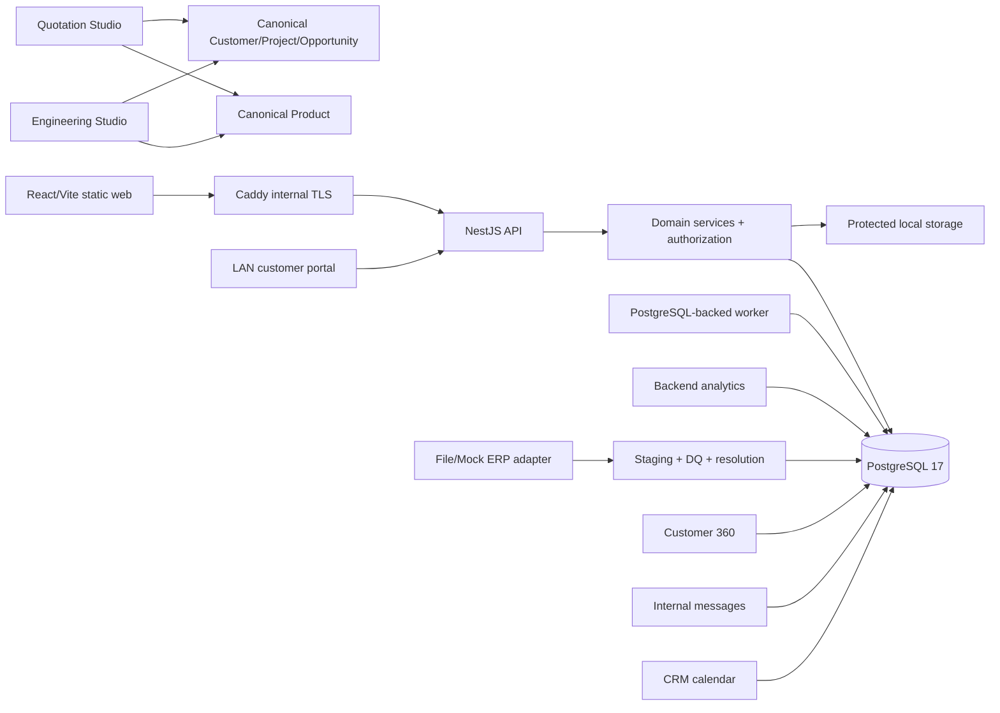

# Self-Hosted System Integration Map

The self-hosted profile has no cloud identity, cloud database, managed queue, paid analytics, public map or hosted file store. Local SMTP is optional; internal notifications/messages/calendar remain PostgreSQL-backed. Engineering, quotation, ERP and Customer 360 must resolve stable canonical IDs and may not create mini-master data stores.
