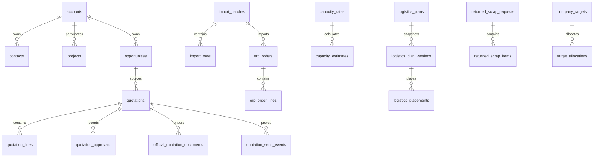

+# Step 6 Physical ERD

Implemented PostgreSQL 17 physical schema. Sales uses `accounts` as the canonical Customer table.

All material links above are enforced by PostgreSQL foreign keys. No formal quotation-revision, internal-order, production/MES, shipment, dispatch, delivery, POD, PersonalTarget, or NetCommercialSales tables exist.
